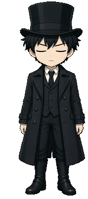
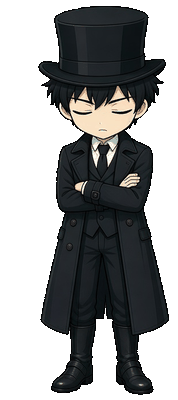

## Nemure

  
   
  <b>Gehrman Sparrow</b>

### 🔭 Highlights

- [Lord of mysteries AI RPG game](https://lotm-site.vercel.app)
- [A betting calculator](https://bettingui.vercel.app)
- [Yinke law (alt site)](https://yinke-next.vercel.app)
- [Personal website](https://themagiche.vercel.app)
- [Fuzzy wasm](https://themagiche.github.io/fuzzy-wasm)
- [Csv-parser wasm](https://themagiche.github.io/wasm-csv-parser)
- [SQL-formatter wasm](https://themagiche.github.io/sql-formatter-wasm)
- [Learn GO basics](https://themagiche.github.io/learn-go)

---

### 🎭 Interactive Gehrman Sparrow

*Click any action below to interact with Gehrman directly:*

  
👉 <b>Poke / Click</b>

   
  

    
     
    <i>"The fool that doesn't belong to this era..."</i>
  

  
🎩 <b>Idle Stance</b>

   
  

    
    
     
    <i>Adjusting spectacles while observing Backlund's fog...</i>
  

  
🥱 <b>Take a Break (Yawn)</b>

   
  

    
     
    <i>*yawns* Even above the gray fog, one grows weary...</i>
  

  
🌙 <b>Rest (Sleep Mode)</b>

   
  

    
    
    
     
    <i>Resting deep above the gray fog.</i>
  

