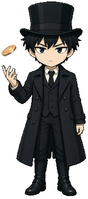
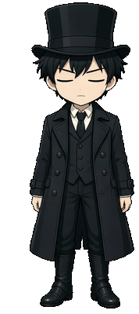
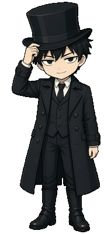
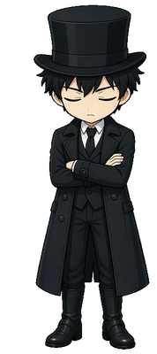

<table>
  <tr>
    <td valign="top" width="190" align="center">
      
       
      <b>Gehrman Sparrow</b>
        
      
       
      <i>Click badge or avatar for live cursor-following widget</i>
    </td>
    <td valign="top">
      <h2>Nemure</h2>
      
      <h3>🔭 Highlights</h3>
      <ul>
        <li><a href="https://lotm-site.vercel.app">Lord of mysteries AI RPG game</a></li>
        <li><a href="https://bettingui.vercel.app">A betting calculator</a></li>
        <li><a href="https://yinke-next.vercel.app">Yinke law (alt site)</a></li>
        <li><a href="https://themagiche.vercel.app">Personal website</a></li>
        <li><a href="https://themagiche.github.io/fuzzy-wasm">Fuzzy wasm</a></li>
        <li><a href="https://themagiche.github.io/wasm-csv-parser">Csv-parser wasm</a></li>
        <li><a href="https://themagiche.github.io/sql-formatter-wasm">SQL-formatter wasm</a></li>
        <li><a href="https://themagiche.github.io/learn-go">Learn GO basics</a></li>
      </ul>

      <h3>🎭 Interactive Actions</h3>
      
<i>Click to interact directly in GitHub:</i>

      

        
<b>👉 Poke Gehrman</b>

        

           
          <i>"The fool that doesn't belong to this era..."</i>
        

      

      

        
<b>🥱 Take a Break (Yawn & Idle)</b>

        

          
           
          <i>Adjusting spectacles while observing the fog...</i>
        

      

      

        
<b>🌙 Rest (Sleep Mode)</b>

        

          
           
          <i>Resting above the gray fog.</i>
        

      

    </td>
  </tr>
</table>
